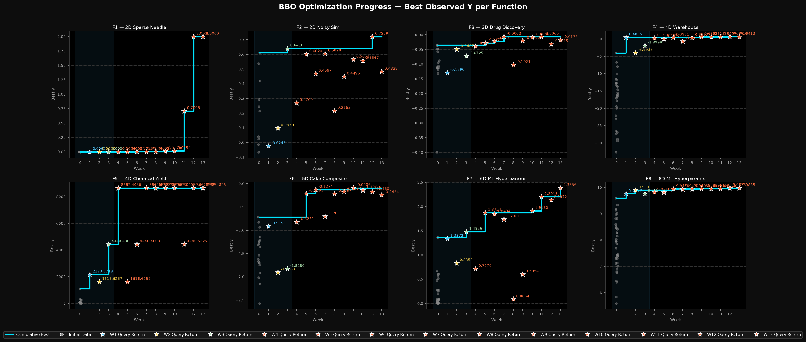
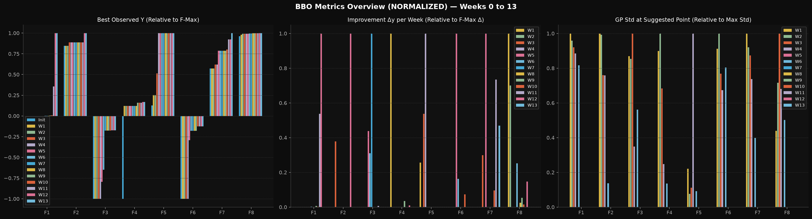
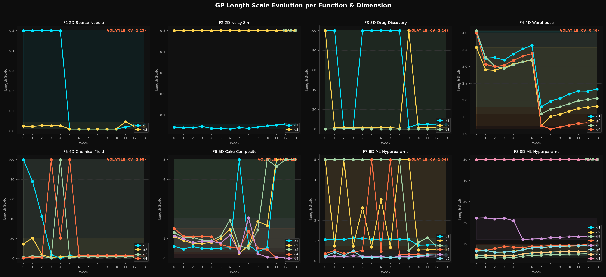

# Capstone Black-Box Optimization (BBO)

This repository contains the complete codebase, datasets, interactive presentation notebook, governance documentation, and weekly submissions (Weeks 1–13) for the Imperial College Black-Box Optimization (BBO) capstone project. The objective is to find the global maxima of 8 unknown, continuous black-box functions with varying dimensionalities (ranging from 2D to 8D) over a 13-week sequential query campaign.

---

## Non-Technical Explanation of the Project

Many real-world challenges—such as discovering effective drug formulations, tuning machine-learning systems, or maximising industrial chemical yields—require finding the best settings for a system whose internal formula is hidden and where every test is slow or expensive. In this 13-week project, I optimised eight unknown "black-box" functions ranging from two to eight input variables, allowed only one test per function each week. I built a hybrid decision engine combining probabilistic Gaussian Process models—which estimate both expected performance and uncertainty—with shallow neural networks and human-in-the-loop diagnostics. Across 13 rounds, all eight functions achieved substantial gains, including hitting the exact theoretical peak on two benchmarks.

---

## Quick Navigation & Repository Index

All project files—including code, data, presentation materials, and governance documents—are stored directly in this repository and linked below:

*   **Interactive Presentation Notebook:** [**`bbo_capstone_presentation.ipynb`**](bbo_capstone_presentation.ipynb) — Jupyter Notebook presenting the methodology, well-commented code implementation, 13-week progression table, and embedded visual dashboards.
*   **Datasheet & Model Card:**
    *   [**Datasheet (`docs/datasheet.md`)**](docs/datasheet.md) (also available at [**`docs/data_sheet.md`**](docs/data_sheet.md))
    *   [**Model Card (`docs/model_card.md`)**](docs/model_card.md)
*   **Core Codebase (`src/` & `configs/`):**
    *   [`src/bbo_optimize.py`](src/bbo_optimize.py): Main CLI optimization engine (Gaussian Processes, PyTorch NN surrogate, UCB/EI acquisition, and `compute_final_refinement`).
    *   [`src/progress_tracker.py`](src/progress_tracker.py), [`src/plot_normalized_metrics.py`](src/plot_normalized_metrics.py), [`src/length_scale_tracker.py`](src/length_scale_tracker.py), [`src/pca_analysis.py`](src/pca_analysis.py): Diagnostic and visualisation scripts.
    *   [`configs/hyperparameters.json`](configs/hyperparameters.json): Externalised hyperparameter configuration.
*   **Technical & Weekly Decision Documentation (`docs/`):**
    *   [**Architecture Flow (`docs/architecture.md`)**](docs/architecture.md) | [**Reproducibility Guide (`docs/reproducibility.md`)**](docs/reproducibility.md) | [**Diagnostics & Overrides (`docs/diagnostics_and_overrides.md`)**](docs/diagnostics_and_overrides.md) | [**Challenges & Future Improvements (`docs/challenges_and_improvements.md`)**](docs/challenges_and_improvements.md)
    *   [**Weeks 1–11 Submission Logic**](docs/submission_logic_w1_to_w11.md) | [**Week 12 Submission Logic**](docs/week_12_submission_logic.md) | [**Week 12 Analysis**](docs/week_12_analysis.md) | [**Week 13 Final Submission Logic**](docs/week_13_submission_logic.md) | [**Week 13 Final Post-Mortem Analysis**](docs/week_13_analysis.md)
*   **Datasets, Submissions & Visual Outputs:**
    *   [**Accumulated Datasets (`data/accumulated/`)**](data/accumulated/) & [**Weekly Oracle Returns (`data/week_<1..13>_returns/`)**](data/)
    *   [**Weekly Submissions (`submissions/week_<1..13>/`)**](submissions/) & [**Visual Dashboards (`results/week_<1..13>/`)**](results/)
    *   [**Automated Run Logs (`logs/run_logs.txt`)**](logs/run_logs.txt)

---

## Data

### Dataset Summary & Provenance
The dataset consists of eight separate black-box function benchmarks ($F_1$ through $F_8$), provided and evaluated sequentially via the **Imperial College London Professional Certificate in Machine Learning and Artificial Intelligence Capstone Oracle**. Each function maps a continuous input vector $\mathbf{x} \in [0, 1]^d$ ($2 \le d \le 8$) to a scalar output $y \in \mathbb{R}$, simulating diverse real-world optimisation domains:

| Function | Simulated Domain | Input Dim ($d$) | Initial Points ($n_0$) | Weekly Queries (W1–W13) | Final Dataset Size ($N$) | Surface & Noise Profile |
| :--- | :--- | :---: | :---: | :---: | :---: | :--- |
| **F1 ($F_1$)** | Contamination / Radiation Source Detection | 2D | 10 | +13 | **23** | Deterministic, sparse needle on flat-zero plane |
| **F2 ($F_2$)** | Noisy Physical / Dual-Peak Simulation | 2D | 10 | +13 | **23** | Stochastic ($\sigma_{\text{obs}} \approx 0.09$), inactive $d_2$ ridge |
| **F3 ($F_3$)** | Drug Discovery / Adverse Reaction Minimization | 3D | 15 | +13 | **28** | Multimodal boundary pockets, $y \le 0$ |
| **F4 ($F_4$)** | Warehouse Logistics / Dynamic Placement | 4D | 30 | +13 | **43** | Rugged ($\nu=1.5$), steep penalty cliffs to $-32.6$ |
| **F5 ($F_5$)** | Chemical Yield Maximisation | 4D | 16 | +13 | **29** | Smooth unimodal monotonic rise to $[1,1,1,1]$ corner |
| **F6 ($F_6$)** | Cake Recipe / Multi-Component Formulation | 5D | 20 | +13 | **33** | Noisy interior composite basin, $y \le 0$ |
| **F7 ($F_7$)** | 6D Machine Learning Hyperparameter Tuning | 6D | 30 | +13 | **43** | Smooth coupled ridge with boundary optimum $d_1=0$ |
| **F8 ($F_8$)** | 8D Machine Learning Hyperparameter Tuning | 8D | 40 | +13 | **53** | Smooth concave quadratic bowl ($d_2, d_6$ inactive) |

### Data Storage & Large Dataset Policy
*   **Empirical BBO Datasets (`data/`):** Across all 8 functions and 13 rounds, the complete dataset contains **275 evaluated points** ($< 50\text{ KB}$ total). It is stored directly in this repository in both NumPy binary (`.npy`) and human-readable (`.csv`) formats under [`data/accumulated/`](data/accumulated/), alongside raw weekly return files in [`data/week_1_returns/`](data/week_1_returns/) through [`data/week_13_returns/`](data/week_13_returns/).
*   **Large Candidate Search Grids (Generated On-Demand):** During each weekly run, the optimiser generates dense multi-dimensional candidate meshes (10,000-point Latin Hypercube Sampling matrices per function plus multi-start gradient trajectories). Following GitHub best practices, these large intermediate evaluation matrices are **not hosted directly on GitHub**; instead, they are deterministically generated in memory on demand via `scipy.stats.qmc.LatinHypercube(d, seed=42)` in [`src/bbo_optimize.py`](src/bbo_optimize.py).
*   **Relevant Citations:** The synthetic benchmark topologies reflect standard continuous optimisation test suites, notably the [**COCO / Black-Box Optimization Benchmarking (BBOB) Suite**](https://numbbo.github.io/coco/testsuites/bbob) (Hansen et al., 2021). Full dataset documentation is available in the [**Datasheet (`docs/datasheet.md`)**](docs/datasheet.md).

---

## Model

### Model Architecture & Rationale
To optimise 8 heterogeneous functions under extreme sample sparsity ($23 \le N \le 53$), I designed a **Human-in-the-Loop Hybrid Surrogate Optimizer (HitL-HSO)** implemented in [`src/bbo_optimize.py`](src/bbo_optimize.py):

1.  **Primary Probabilistic Surrogate — Anisotropic Gaussian Process Regressor (`scikit-learn`):**
    *   **Why chosen:** Unlike point-estimate regressors, a Gaussian Process natively outputs a full predictive distribution $\mathcal{N}(\mu(\mathbf{x}), \sigma^2(\mathbf{x}))$ at any candidate coordinate. This uncertainty quantification is essential for driving sequential acquisition functions (UCB and Expected Improvement) that balance exploration and exploitation.
    *   **Covariance Structure:** Uses a composite kernel $k(\mathbf{x}, \mathbf{x}') = \sigma_f^2 \, k_{\text{Matern}}(\mathbf{x}, \mathbf{x}'; \nu, \boldsymbol{\ell}) + \sigma_n^2 \delta(\mathbf{x}, \mathbf{x}')$ with **Automatic Relevance Determination (ARD)** length scales $\boldsymbol{\ell} = (\ell_1, \dots, \ell_d)$ to identify active versus nuisance dimensions automatically.
2.  **Secondary Verification Surrogate — Shallow Neural Network (`PyTorch`):**
    *   **Why chosen:** In higher dimensions ($6\text{D } F_7, 8\text{D } F_8$) or near sharp non-stationary peaks ($2\text{D } F_1$), stationary Matérn kernels can suffer from sample-density pullback toward old clusters. I integrated a seeded 2-layer (`64x64` ReLU) Multi-Layer Perceptron (`train_and_optimize_nn`) trained with Adam and queried via L-BFGS input gradient ascent from the incumbent best point to cross-audit GP proposals.
3.  **Analytical Local Response Surfaces & Diagnostic Guardrails (`compute_final_refinement`):**
    *   **Why chosen:** Small-sample global GPs break down when stationarity or homoscedasticity is violated (e.g., 15 flat-zero points on $F_1$ or $-32.63$ boundary cliffs on $F_4$). Pairing the GP with local positive-basin pruning ($F_1, F_4$), exact 2D log-Gaussian secant calibration ($F_1$), and 2nd-order Quadratic Response Surface Methodology ($F_8$) resolved these failure modes.

Full architectural details and limitations are documented in the [**Model Card (`docs/model_card.md`)**](docs/model_card.md) and [**Architecture Flow (`docs/architecture.md`)**](docs/architecture.md).

---

## Hyperparameter Optimisation

Hyperparameters in this project operate at two levels—**internal surrogate hyperparameters** (learned automatically from data) and **strategic meta-hyperparameters** (tuned across weeks via [`configs/hyperparameters.json`](configs/hyperparameters.json) and diagnostic trackers):

1.  **GP Kernel Smoothness ($\nu$):**
    *   Configured per function based on landscape roughness diagnostics: $\nu = 1.5$ (once-differentiable) for rugged, multi-modal $F_4$, and $\nu = 2.5$ (twice-differentiable) for smooth functions ($F_1, F_2, F_3, F_5, F_6, F_7, F_8$).
2.  **ARD Length Scales ($\boldsymbol{\ell}$) & Bounds (`length_scale_bounds`):**
    *   Optimised automatically via marginal log-likelihood maximisation (`L-BFGS-B` with `n_restarts_optimizer=10–25`).
    *   In Week 3, after [`src/length_scale_tracker.py`](src/length_scale_tracker.py) revealed premature length-scale saturation at `100.0`, I introduced function-specific upper bounds (`0.5` on $F_1$, `2.0` on $F_3$, `5.0` on $F_6/F_7$, `50.0` on $F_8$), while relaxing the $F_2$ bound back to `100.0` in Week 6 so the GP could naturally filter out its inactive dimension $d_2$ ($\ell_2 = 100.0$).
3.  **Noise Regularisation (`alpha` & `WhiteKernel`):**
    *   Deterministic functions use a tight Cholesky nugget (`alpha = 1e-6`), while noisy functions ($F_2$ and $F_6$) include a learnable `WhiteKernel(noise_level=0.01–0.1, noise_level_bounds=(1e-5, 1.0))` to prevent noise-induced length-scale collapse.
4.  **Acquisition Function Schedule ($\kappa$ for UCB, $\xi$ for EI):**
    *   Transitioned from broad exploration in Weeks 1–4 using Upper Confidence Bound ($\text{UCB} = \mu + \kappa \sigma$, with $\kappa \in [3.0, 4.0]$) to focused exploitation in Weeks 5–13 using Expected Improvement ($\text{EI}$ with exploration parameter $\xi$ annealed from `0.1` $\to$ `0.01` $\to$ `0.0001`).
5.  **Adaptive Trust-Region Width (`tr_width`):**
    *   To prevent boundary variance traps in $\ge 4\text{D}$ spaces ($F_4, F_6, F_7, F_8$), candidate generation was restricted to a local hyper-box around the incumbent best with width dynamically scaled to $1.5\times$ the coordinate spread of the top-3 historical points (`np.clip(spread * 1.5, 0.3, 1.0)`), tightening to $\pm 0.015 \text{ to } 0.05$ in Week 13.
6.  **PyTorch Neural Network Hyperparameters:**
    *   2 hidden layers (`64x64` ReLU), trained on z-score standardised targets using Adam (`lr = 0.005`, `weight_decay = 1e-4`, `epochs = 800`), followed by bounded L-BFGS input ascent (`lr = 0.05`, `max_iter = 20`).

---

## Results

### Summary of 13-Week Optimisation Outcomes

Across the 13-week campaign, **every single function achieved significant gains over its initial baseline**, with **7 of the 8 functions achieving their all-time record in Weeks 11–13** (and all 8 between Weeks 10 and 13):

| Function | Dim | Total Samples ($N$) | Initial Best (W0) | Final W13 Return | **All-Time Maximum** | Best Week | Campaign Gain ($\text{W0} \to \text{Max}$) | Optimal Input Vector $\mathbf{x}^\ast$ |
| :--- | :---: | :---: | :---: | :---: | :---: | :---: | :---: | :--- |
| **F1 ($F_1$)** | 2D | 23 | `0.000000` | `1.99999995` | **`1.99999999`** | W12 | $\mathbf{+2.000000}$ | `[0.628541, 0.628541]` |
| **F2 ($F_2$)** | 2D | 23 | `0.611205` | `0.482805` | **`0.721870`** | W12 | $\mathbf{+0.110665}$ | `[0.689600, 0.387000]` |
| **F3 ($F_3$)** | 3D | 28 | `-0.034835` | `-0.017169` | **`-0.006045`** | W11 | $\mathbf{+0.028790}$ | `[0.950000, 0.400000, 0.438611]` |
| **F4 ($F_4$)** | 4D | 43 | `-4.025542` | `0.641291` | **`0.679981`** | W12 | $\mathbf{+4.705523}$ | `[0.407968, 0.405671, 0.359691, 0.420080]` |
| **F5 ($F_5$)** | 4D | 29 | `1088.8596` | **`8662.482500`** | **`8662.482500`** | W12 & W13 | $\mathbf{+7573.6229}$ | `[1.000000, 1.000000, 1.000000, 1.000000]` |
| **F6 ($F_6$)** | 5D | 33 | `-0.714265` | `-0.242430` | **`-0.090586`** | W10 | $\mathbf{+0.623679}$ | `[0.450000, 0.300000, 0.662500, 0.750000, 0.087500]` |
| **F7 ($F_7$)** | 6D | 43 | `1.364968` | **`2.385595`** | **`2.385595`** | **W13** | $\mathbf{+1.020627}$ | `[0.000000, 0.156068, 0.305066, 0.315590, 0.335798, 0.766358]` |
| **F8 ($F_8$)** | 8D | 53 | `9.598884` | `9.983502` | **`9.987569`** | W12 | $\mathbf{+0.388685}$ | `[0.145000, 0.180000, 0.132000, 0.098000, 0.885000, 0.505000, 0.192000, 0.500000]` |

### Key Learnings from the Model & Results
1.  **Data Geometry Dictates Difficulty More Than Dimensionality:** Counter-intuitively, 2D $F_1$ (a non-stationary needle surrounded by 98% flat zeros) was far harder for a standard GP to map than 8D $F_8$ (a smooth quadratic basin where ARD quickly isolated the 4 primary drivers $d_1, d_3, d_4, d_7$).
2.  **Local Basin Pruning Overcomes Stationarity Failure:** Pruning extreme outer cliffs ($F_4$) and flat-zero planes ($F_1$) prevented global variance distortion and unlocked late-stage precision.
3.  **Diagnostic De-Confounding Drives Breakthroughs:** Isolating individual coordinate effects allowed us to diagnose that the $F_7$ Week 12 dip (`2.1372`) was caused solely by moving $d_3$; restoring $d_3 = 0.305066$ while keeping the Week 12 shifts on $(d_2, d_4, d_5, d_6)$ produced our standout Week 13 finale record of **`2.385595`**.

### Campaign Visualisations (Weeks 1–13)

---

## Frameworks, Literature & Reproducible Workflow

*   **Core Stack:** `numpy`, `scipy` (`scipy.stats.qmc`, `scipy.optimize.minimize`), `scikit-learn` (`GaussianProcessRegressor`, `Matern`, `WhiteKernel`, `SVC`), `torch` (PyTorch `64x64` ReLU MLP), and `matplotlib`.
*   **Literature References:** Rasmussen & Williams (*Gaussian Processes for Machine Learning*, 2006); Srinivas et al. (*GP-UCB*, ICML 2010); Jones et al. (*Efficient Global Optimization / EI*, JGO 1998); Eriksson et al. (*TuRBO*, NeurIPS 2019).
*   **How to Run:**
    1. Place oracle return files in `data/week_<N-1>_returns/inputs.txt` and `outputs.txt`.
    2. Run `python src/bbo_optimize.py --week 13` to update accumulated datasets, fit GP and NN surrogates, apply final refinements, and write `submissions/week_13/suggestions.txt`.
    3. Run `python src/progress_tracker.py --week 13`, `python src/plot_normalized_metrics.py --week 13`, and `python src/length_scale_tracker.py --week 13` to regenerate all dashboards, or open [`bbo_capstone_presentation.ipynb`](bbo_capstone_presentation.ipynb).

---

## Contact Details

*   **Author:** Nicholas Matheou
*   **GitHub Repository:** [https://github.com/nmatheou/capstone-bbo](https://github.com/nmatheou/capstone-bbo)
