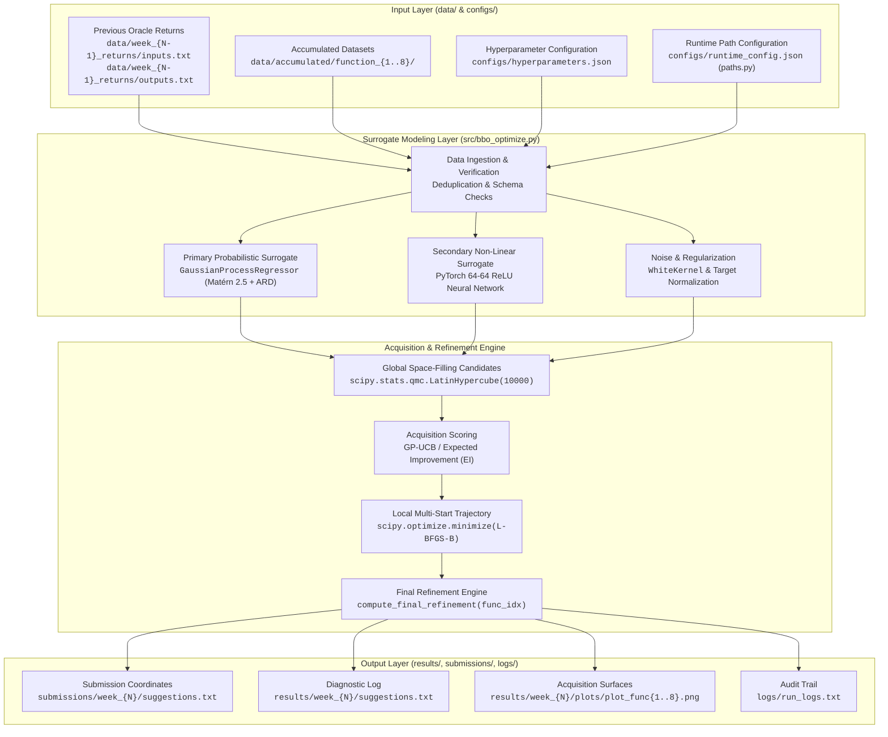

# BBO Optimization Architecture

This document describes the software architecture, data flow, and modeling pipeline of the **Human-in-the-Loop Hybrid Surrogate Optimizer (HitL-HSO)**.

---

## 1. System Data Flow Architecture

The diagram below illustrates how inputs, surrogate modeling, acquisition maximization, refinement, and outputs interact across the repository structure:

---

## 2. Core Architectural Components

### 1. Robust Path & Configuration Engine (`src/paths.py`)
- **Self-Configuring Root Resolution:** Automatically determines the repository root directory on any host machine without hardcoded paths.
- **First-Run Setup:** Prompts the user interactively (or defaults to the repository root when non-interactive) and caches the setting in `configs/runtime_config.json` (git-ignored).
- **Pre-Flight Validation:** Verifies that all required input folders (`data/accumulated/`, `configs/hyperparameters.json`, and `data/week_{N-1}_returns/`) exist before executing modeling steps.
- **Automatic Directory Creation:** Creates output folders (`results/week_{N}/`, `results/week_{N}/plots/`, `logs/`, and `submissions/week_{N}/`) dynamically if missing.
- **CLI & Environment Overrides:** Fully respects `--output-dir <path>` arguments and `BBO_OUTPUT_DIR` environment variables.

### 2. Primary Surrogate Modeling (scikit-learn GPs)
- **Engine:** `sklearn.gaussian_process.GaussianProcessRegressor`.
- **Kernel Strategy:** Matérn kernel ($\nu=2.5$ or $\nu=1.5$) with independent Automatic Relevance Determination (ARD) length scales:
  $$\Theta = (\ell_1, \dots, \ell_d)$$
- **Noise Accommodation:** Deterministic functions ($F_1, F_5$) use small Tikhonov jitter (`alpha=1e-6`); stochastic benchmarks ($F_2, F_6$) include an explicit `WhiteKernel(noise_level=1.0)`.
- **Preprocessing:** Target z-score normalization (`StandardScaler` / `normalize_y=True`) stabilizes hyperparameter marginal likelihood optimization, particularly on high-scale landscapes (e.g., $F_5$).

### 3. Secondary Surrogate Modeling (PyTorch 64-64 ReLU MLP)
- **Engine:** Fully connected two-layer neural network with 64 hidden units per layer, ReLU activation, Adam optimizer (`lr=0.01`), and fixed seed (`torch.manual_seed(42)`).
- **Role:** Serves as an independent inductive bias to corroborate GP recommendations and drive directional momentum in high dimensions ($F_8$).

### 4. Acquisition & Local Trust-Region Refinement (SciPy)
- **Candidate Sampling:** `scipy.stats.qmc.LatinHypercube(d, seed=42)` samples 10,000 space-filling candidates across $[0, 1]^d$.
- **Acquisition Functions:**
  - **Upper Confidence Bound (UCB):**
    $$\alpha_{\text{UCB}}(\mathbf{x}) = \mu(\mathbf{x}) + \kappa \cdot \sigma(\mathbf{x})$$
  - **Expected Improvement (EI):**
    $$\alpha_{\text{EI}}(\mathbf{x}) = (\mu(\mathbf{x}) - y^+ - \xi)\Phi(Z) + \sigma(\mathbf{x})\phi(Z)$$
- **Multi-Start Continuous Polish:** `scipy.optimize.minimize(method="L-BFGS-B")` polishes the top acquisition candidates.
- **Function-Specific Refinement (`compute_final_refinement`):** Applies tailored mathematical post-processing (e.g., analytical log-Gaussian step on $F_1$, 1D ridge lock on $F_2$, boundary lock on $F_3$, positive-basin GP on $F_4$, hyper-corner lock on $F_5$, and neural network momentum on $F_8$).

### 5. Diagnostics & Visualization Pipeline
- `src/progress_tracker.py`: Computes 13-week cumulative performance trajectories and best-to-date scores.
- `src/plot_normalized_metrics.py`: Computes min-max normalized GP metric evolution across all functions.
- `src/length_scale_tracker.py`: Tracks ARD length scales and Coefficient of Variation (CV) to diagnose dimensional activity.
- `src/dim_sensitivity_sweep.py`: Conducts 1D slice sweeps across $[0, 1]$ around $\mathbf{x}^\ast$ to test directional sensitivity.
- `src/pca_analysis.py`: Performs principal component decomposition on empirical query distributions.
